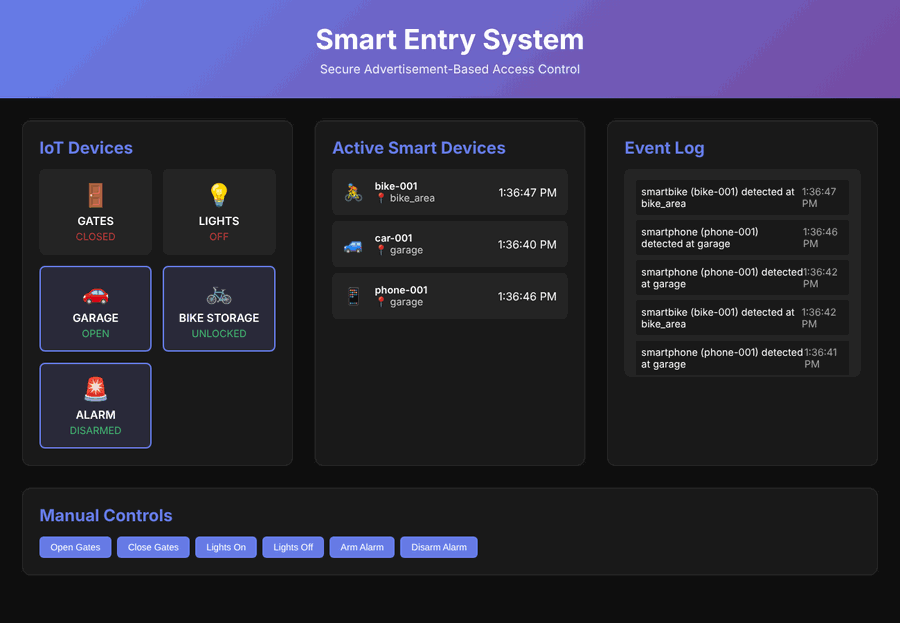

# Smart Entry System

**Secure proximity-based access control for IoT, using cryptographic advertisements instead of MAC addresses.**

Many smart-home systems open a door when they "see" the owner's phone, usually by its MAC address. MAC addresses are easy to spoof, so an attacker can copy one and walk in. This project replaces MAC-based identification with **HMAC-signed, time-limited advertisements**, adding replay protection, rate limiting and per-device permissions.

University project (University of Messina, course of Prof. Massimo Villari and Prof. Armando Ruggeri), built by **Sepehr Mojdehdehbaher** and **Fatemeh Baghchei**.



## How it works

```
 Smart devices ──advertise──► Gateway ──actuate──► IoT devices
 (simulated phone,            │   ▲                (gates, lights, garage,
  car, bike)                  │   │                 bike storage, alarm)
      │                verify │   │ result
      └──register──► Auth server ◄┘
                              
 Gateway ──WebSocket──► Web dashboard (live status, event log, manual controls)
```

| Service | Tech | Role |
|---|---|---|
| `auth-server` | Python, Flask | Registers devices, derives per-device keys, verifies signatures, blocks replays |
| `gateway` | Python, Flask, Socket.IO | Receives advertisements, rate-limits, applies zone rules, drives IoT devices, pushes live updates |
| `device-simulator` | Python | Simulates smartphones, a car and a bike moving between zones and signing advertisements |
| `frontend` | HTML, CSS, JavaScript, Nginx | Real-time dashboard |

All four services run in Docker containers, orchestrated with Docker Compose.

## Security features

- **Authentication and integrity**: every advertisement is signed with HMAC-SHA256 using a per-device key.
- **Freshness**: messages older than 30 seconds are rejected.
- **Replay protection**: each message carries a random nonce; reused nonces are rejected.
- **Rate limiting**: more than 30 requests per minute blocks the device for 5 minutes.
- **Access control**: permissions depend on device type and zone (for example, a bike can open the bike storage but not the garage).
- **Proximity check**: simulated signal strength (RSSI) and response time must be within limits.
- **Audit log**: authentications, failures and manual actions are logged and shown live.

## Run it

Requirements: Docker and Docker Compose.

```bash
git clone https://github.com/Sepi-X/smart-entry-system.git
cd smart-entry-system
docker compose up --build
```

Then open **http://localhost:8080**. After about 10 seconds the simulated devices register and start moving between zones.

## Tests

With the services running:

```bash
pip install requests
python tests/test_security.py
```

The script checks 8 cases: a valid advertisement is accepted, and a replayed message, a wrong signature, an expired message, an unknown device, a bike trying to open the garage, a request flood, and re-registration with a different secret are all rejected.

```
8/8 tests passed
```

## API

**Auth server (port 5000)**: `POST /register`, `POST /verify_advertisement`, `GET /devices`, `GET /health`

**Gateway (port 5001)**: `POST /advertise`, `GET /status`, `POST /control/<device>`, `GET /security/events`

## Limitations and next steps

This is a proof of concept with simulated devices, not a production system:

- The shared secret is sent once at registration. A real deployment would provision keys securely (for example at manufacture) and use TLS.
- RSSI and response time are simulated. Real proximity would need BLE hardware or ultra-wideband distance bounding.
- The manual control endpoint has no admin authentication yet.
- State is kept in memory, so it resets when the services restart.

## Project report

The full report (architecture, threat model, test results) was submitted for the course and is available on request.
